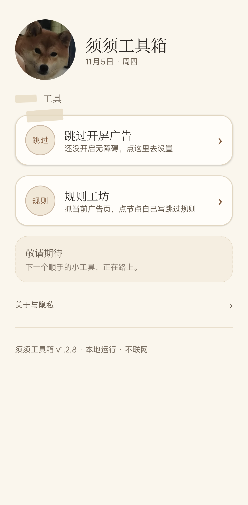
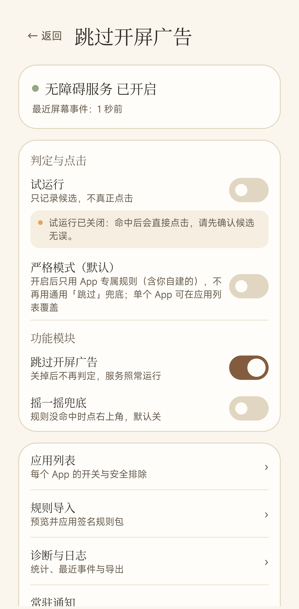
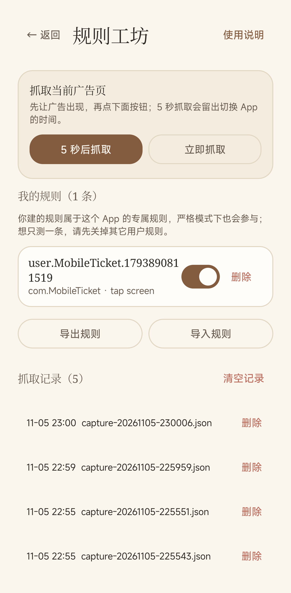
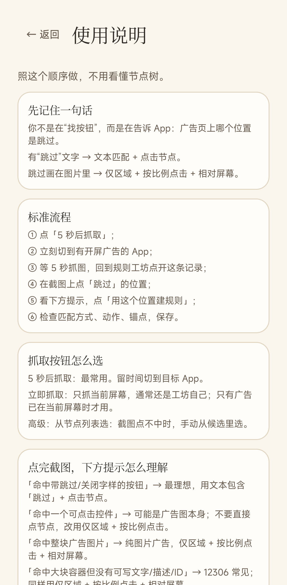

# 须须工具箱（xuxutoolbox）

一个本地运行、不联网的 Android 小工具，目前主要功能是**自动跳过 App 开屏广告**。

当前正式版：**1.2.8**（versionCode 11）。安装包与发布说明见 [Releases](https://github.com/gzy-geizen/xuxutoolbox/releases)。

- 不申请网络权限，不上传任何数据
- 默认「试运行」：只记录候选、不真正点击；确认无误后再关闭
- 内置常见 App 规则，也支持自己抓取广告页、点一下「跳过」生成规则
- 规则工坊内置**使用说明**，照着顺序做，不用看懂节点树
- 手账风格界面，支持深色模式

## 两个主要功能

### 1. 自动跳过开屏广告

打开 App 出现开屏广告时，自动识别「跳过 / 关闭」并点击。

- 内置贴吧、QQ 浏览器、中国移动、中国广电、12306、迅雷等 App 的专属规则；没有专属规则的 App 用通用「跳过」兜底。
- 严格模式：只用 App 专属规则（含你自建的），不用通用兜底；也可以只对某个 App 单独设置。
- 默认开启「试运行」：只记录候选、不真正点击；确认候选无误后再关闭。
- 点击前会做安全检查：包名、启动时间窗、冷却时间、每窗口点击次数。
- 纯图片广告（无障碍树里没有「跳过」按钮）支持按屏幕比例点击。
- 应用列表里可以逐个 App 关闭跳过；关闭后该 App 不再自动跳过。

### 2. 规则工坊

给没有内置规则、或内置规则不适配的 App 自己做一条规则。

- 点「5 秒后抓取」，立刻切到有开屏广告的 App，5 秒后自动截取当前窗口。
- 回到规则工坊打开这条记录，直接在截图上点平时点「跳过」的位置。
- 程序自动判断匹配方式（文本、描述、控件 ID、区域）和动作（点击节点、按比例点击），确认后保存。
- 图片广告没有可点的「跳过」节点时，会生成「仅区域 + 按比例点击 + 相对屏幕」的规则。
- 支持开关、删除本地规则，导入签名规则包，导出本地规则。
- 内置「使用说明」，按顺序操作即可，不需要看懂节点树。
- 规则只保存在本机，不联网。

两个功能共用同一个无障碍服务；关闭「跳过开屏广告」模块后，规则工坊里的规则不会执行，但服务和工坊仍可正常使用。

## 功能截图

| 首页 | 跳过开屏广告 |
| --- | --- |
|  |  |

| 规则工坊 | 内置使用说明 |
| --- | --- |
|  |  |

## 工作原理

1. 无障碍服务监听窗口事件，只读取当前窗口的控件文字/描述与位置。
2. 规则引擎判断是否存在开屏广告的「跳过 / 关闭」按钮。
3. 安全闸检查包名、时间窗、冷却与每窗口点击次数；命中后由无障碍手势点击。
4. 默认不开网络，规则与日志都只保存在本机。

规则分为两层：

- `app`：针对某个 App 的专属规则，优先匹配
- `generic`：通用兜底规则（严格模式下不参与）

用户可以在「规则工坊」里抓取广告页，直接在截图上点「跳过」的位置，生成一条本地规则。

## 环境要求

- Android Studio（或 Android SDK），compileSdk 37、targetSdk 36、minSdk 31
- JDK 21 或更高（本项目在 JBR 25 上构建通过）
- Gradle 9.6.0（仓库自带 wrapper）

## 构建

```bash
# Windows
gradlew.bat :app:assembleDebug

# macOS / Linux
./gradlew :app:assembleDebug
```

产物：`app/build/outputs/apk/debug/app-debug.apk`

单元测试：

```bash
gradlew.bat :app:testDebugUnitTest
```

### Release 签名

仓库**不包含**任何签名文件。要打正式 release 包，请自己创建 keystore，并在根目录放置 `keystore.properties`：

```properties
storeFile=keystore/your.jks
storePassword=******
keyAlias=******
keyPassword=******
```

没有 keystore 时，release 构建会直接失败，避免误把 debug 签名包当正式包发布。

### 规则签名工具

`tools/KeyGen.java` 与 `tools/RuleSigner.java` 可用于生成本地规则签名密钥、给规则包签名。私钥不要提交到仓库。

## 目录结构

```
app/                主应用（Compose UI、无障碍服务、规则引擎）
fakead/             测试桩：模拟开屏广告，用于验证跳过逻辑
gradle/             Gradle wrapper 与版本目录
tools/              规则签名小工具
screenshots/        README 截图
```

## 隐私与安全

- 不申请 `INTERNET` 权限
- 不读取输入内容、不记录账号密码、不截屏上传
- 抓取记录与规则只保存在应用私有目录，可随时在规则工坊删除
- 无障碍服务只用于判断和点击开屏广告的跳过/关闭控件，可在系统设置中随时关闭

## 免责声明

本项目为个人学习与自用工具，按「现状」提供，不保证适配所有应用与广告形态。使用本工具产生的误点、账号或财产损失，由使用者自行承担。请先保持试运行，确认候选无误后再关闭。

## 第三方与致谢

- Kotlin、Jetpack Compose、kotlinx.serialization 等，遵循各自 Apache-2.0 等开源许可
- 设计思路参考过开源项目 SKIP 的规则组织方式，但**未复制其 GPL 代码**；本项目代码为独立实现

## License

Apache License 2.0，见 [LICENSE](LICENSE)。

Copyright 2026 xuxutoolbox contributors.
